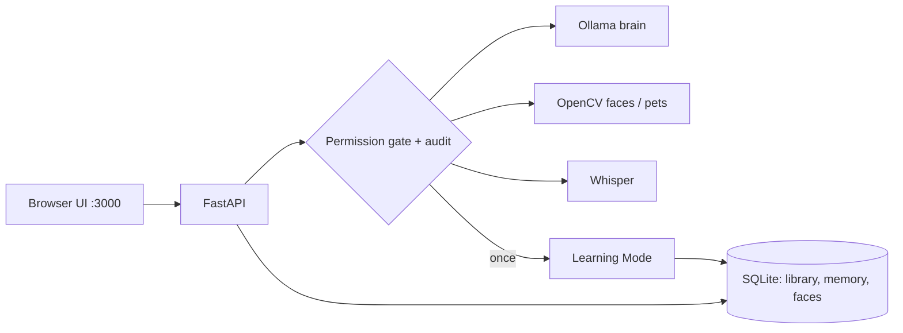

# Mini: offline personal AI companion

Open **http://localhost:3000** after `scripts\start.bat`. Everything runs on your computer.

## Setup (Windows, once, with internet)
1. Install Python 3.11+ (tick "Add to PATH") and Ollama (ollama.com).
2. Run `scripts\install.bat`. It downloads the brain (Qwen), embeddings, vision models and Whisper.
3. Run `scripts\start.bat`. After step 2 you can unplug the internet.
To carry it on a USB/SSD drive, copy the whole folder (including `.venv`, `data`, `models`) and the Ollama models folder; set `OLLAMA_MODELS` to the drive.

## What runs offline
| Ability | Engine |
|---|---|
| Thinking | Ollama (qwen2.5:7b default; set MINI_MODEL for llama3.1:8b or deepseek-r1:7b) |
| Your knowledge library (PDF, DOCX, TXT, MD, CSV, code) | local embeddings (nomic-embed-text) + SQLite |
| Hearing | faster-whisper |
| Speaking | your OS voices (female voice preselected if available) |
| Faces | OpenCV YuNet + SFace |
| Pets | MobileNetV2 similarity (approximate) |
| Scene description | Ollama moondream |
| Self-improvement | the local model; every change is logged and undoable |

Internet is used only if you approve "learn about X" (Wikipedia), then it is closed again.

## Architecture

